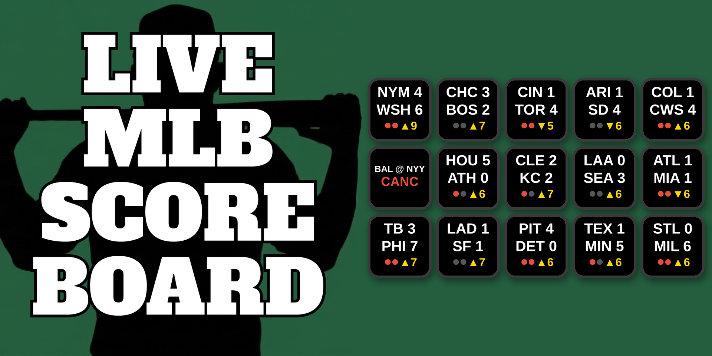
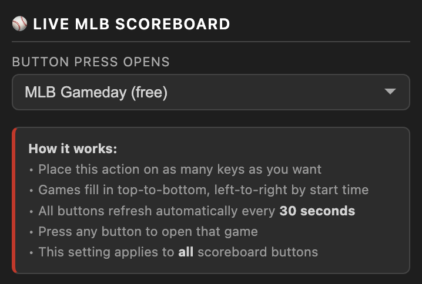
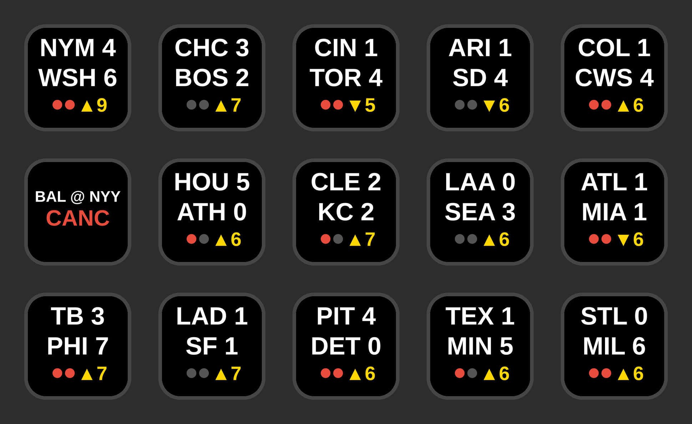

# Live MLB Scoreboard — Stream Deck Plugin



A Stream Deck plugin that displays today's full MLB schedule across multiple keys — one game per key, updating live every 30 seconds. Designed for the Stream Deck XL or any setup with 15 or more keys.

  [](https://marketplace.elgato.com/product/live-mlb-scoreboard-c550e6e1-4161-49ec-9748-2b53dc164e31)

---

## Features

- **Full day at a glance** — every game on today's schedule gets its own key
- **Live scores** — shows away score, home score, and current inning while a game is in progress
- **Pre-game** — shows the matchup (e.g. `NYM @ LAD`) and scheduled start time
- **Final scores** — shows the final score with a "Final" label
- **Score-change flash** — when a team scores, that game's key blinks in the scoring team's primary color, then shows a short card with the team and how many runs scored (e.g. ATL / +2 RUNS)
- **Special states** — postponed games show `PPD`, suspended games show `SUSP`, rain delays show `DELAY`
- **Doubleheader support** — both games each get their own key with G1/G2 labels so you always know which game is which
- **Browser shortcut** — press any key to open that game in MLB Gameday or MLB.tv
- **Overflow indicator** — if there are more games than keys, the last key shows how many are off-screen and opens MLB Scores on press
- **No-flicker updates** — keys only redraw when the display actually changes
- **Shared settings** — fill order, link type, and finals placement apply to all keys at once
- **Completed games to the end** — optionally push finished games to the back of the list so live and upcoming games stay up front. **Tip for smaller Stream Decks** (Mini, Neo, a 15-key MK.2): turn this on, so live and upcoming games keep their keys and finished games move to the `+N more` key.
- **Multi-device support** — a physical Stream Deck and a Virtual Stream Deck (or any combination of connected devices) each get their own independent board, starting from game 1, instead of splitting one combined list between them

---

## Recent Updates

**v1.0.26.0**
- Score flash is now 5 solid blinks of the scoring team's color with no text, so it reads at a glance even on light team colors
- New: right after the flash, a 3-second card shows the scoring team and how many runs scored (e.g. ATL / +2 RUNS), then the score returns
- Settings help text now says "key" instead of "button"
- Fixed: with Scoreboard keys on more than one Stream Deck (e.g. a physical deck plus a Virtual Stream Deck or Stream Deck Mobile), only one of them flashed for a run or played the end-of-game fireworks — now every deck does
- Coming back to a page with Scoreboard keys now just shows the current scores, instead of replaying a flash or fireworks for what happened while you were on another page (matches the other plugins)

**v1.0.25.0**
- Rained-out games that MLB cancels outright now show CANC instead of a 0-0 "Final" (doubleheaders included)
- Doubleheader keys (G1/G2) now use the same text sizes as Live MLB Scores

**v1.0.24.0**
- Added a high-resolution (2x) plugin icon so it stays sharp on Retina/high-DPI displays
- Plugin description now recommends 15 or more keys, matching a full regular-season slate
- Removed a stray macOS system file from the installer
- Turned off Node debug mode for release builds

Older updates: see the full version history in [CHANGELOG.md](CHANGELOG.md).

---

## Requirements

- [Elgato Stream Deck](https://www.elgato.com/stream-deck) hardware (XL or Virtual Stream Deck recommended) or the [Stream Deck Mobile](https://www.elgato.com/stream-deck-mobile) app
- [Stream Deck software](https://www.elgato.com/downloads) version 6.0 or later (Mac or Windows)
- No account required to view scores — the plugin uses MLB's free public stats API
- An MLB.tv subscription is required only if you choose the MLB.tv link option; Gameday is free

---

## Installation

**Elgato Marketplace (recommended)**

1. Open **[Live MLB Scoreboard on the Elgato Marketplace](https://marketplace.elgato.com/product/live-mlb-scoreboard-c550e6e1-4161-49ec-9748-2b53dc164e31)** and install it from there
2. The plugin will appear in the Stream Deck action picker under **Live MLB Scoreboard**

**Manual install**

1. Download the latest **`Live MLB Scoreboard.streamDeckPlugin`** from the [Releases](../../releases) page
2. Double-click the file — Stream Deck will install it automatically

---

## Setup

1. Drag the **Live MLB Scoreboard** action onto as many keys as you want
2. In the settings panel, choose your fill order:
   - **Top-to-bottom, left-to-right** (default) — fills each column before moving to the next
   - **Left-to-right, top-to-bottom** — fills each row before moving to the next
3. In the settings panel, choose what happens when you press a key:
   - **MLB Gameday (free)** — opens the game's live Gameday page in your browser
   - **MLB.tv (subscription)** — opens the game's MLB.tv broadcast page



That's it. All keys will populate within a few seconds and refresh automatically every 30 seconds.

> **Note:** If MLB.tv is selected but the game hasn't started yet (and is more than 60 minutes away), pressing the key will open Gameday instead.

---

## How Many Keys Do I Need?

A full regular season day has up to **15 games**. The Stream Deck XL (32 keys) gives you plenty of room. A virtual Stream Deck works great too.

During **Spring Training**, Split Squad days can push the total above 15 — consider adding extra keys to make sure you catch every game.

---

## What the Keys Show



**Before the game:**
```
NYM @ LAD
10:10 PM
```

**Live game:**
```
NYM  2
LAD  1
 ▲7
```

**Final score:**
```
NYM  2
LAD  1
Final
```

**Postponed / Suspended / Delayed:**
```
NYM @ LAD
   PPD
```
```
NYM @ LAD
  DELAY
```

---

## How It Works

The plugin polls [MLB's free public Stats API](https://statsapi.mlb.com) once every 30 seconds — a single shared request for all keys at once. Games are sorted by start time and distributed to keys in column-major order (top-to-bottom, left-to-right). No API key or account is required. The plugin is fully self-contained and uses only Node.js built-in modules.

The schedule holds on the current day's games until 2 AM local time, so late-running games stay on the board until they finish.

---

## Uninstalling

Open Stream Deck → Preferences → Plugins, select **Live MLB Scoreboard**, and click the **−** key.

---

## Contributing

Bug reports and feature requests are welcome — open an [Issue](../../issues) to get started.

---

## Disclaimer

This plugin is not affiliated with, endorsed by, or sponsored by Major League Baseball or MLB Advanced Media, L.P. All data is sourced from the MLB Stats API and is subject to MLBAM's terms of use. This plugin is intended for individual, personal, non-commercial use only.

---

## Credits

Created by **T.J. Lauerman aka ThatSportsGamer**

Created with Claude Cowork by Anthropic

Data provided by the [MLB Stats API](https://statsapi.mlb.com)
